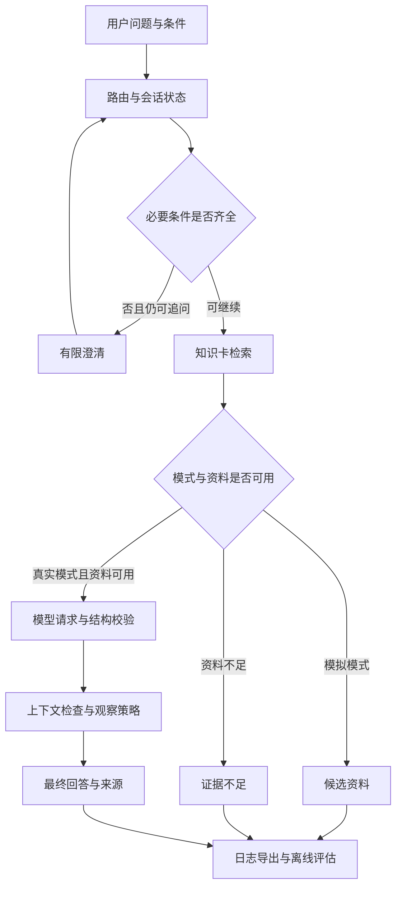

# LureSense 求职展示版

## 项目定位

一个面向淡水大口黑鲈知识问答和现场观察的受约束 RAG 工作流。
核心问题：系统如何在现场信息不完整、用户修正条件、模型生成过强结论时，保留可追溯依据并约束回答。

任务路由和执行流程由代码定义。项目不是自主规划或动态多工具选择的通用 Agent。

## 系统流程



## 工程选择

| 设计 | 收益 | 代价和边界 |
|---|---|---|
| 显式状态字段和 corrected 标记 | 可以检查条件更新是否生效 | 自然语言抽取仍有边界 |
| 每会话请求预算 | 控制重试与用量 | 无法无限澄清复杂情景 |
| 本地知识卡和来源元数据 | mock 可离线展示，便于追溯 | 规模有限，来源需维护 |
| JSON 和引用结构校验 | 拒绝部分格式与编号问题 | 不证明语义支持 |
| 上下文规则 | 可解释地拦截部分冲突 | 存在漏拦、误拦风险 |
| 分开保存模型与规则输出 | 避免把规则收益算作模型能力 | 需要分别评估 |
| 默认仅本机 Web 服务 | 方便本地演示 | 不代表公网生产部署 |

## 可复现实验

程序根目录运行，Python 3.11+，新增工具无需第三方依赖：

```bash
python3 doctor.py
python3 -m unittest discover -s tests -v
mkdir -p runs/guard_eval
python3 guard_experiments.py run --dataset eval/guard/dev_v1.json --out runs/guard_eval/external_baseline_01.json
```

输出文件必须不存在。保留原 evaluate_guard.py 与 dev_01.json，作为旧基线。

本次包的规则开发集沿用已公开的 10 条人工案例，基线 TP=3、FP=0、TN=5、FN=2。
新增实验工具测试 7 项，已在可用代码副本上通过；现有 161 项测试亦通过。
用户最新本地版本须在安装后执行实际测试；测试数量不是质量分数。

未来修改规则后，在相同评估集上运行到新文件，然后比较：

```bash
python3 guard_experiments.py run --dataset eval/guard/dev_v1.json --out runs/guard_eval/external_candidate_01.json
python3 guard_experiments.py compare --before runs/guard_eval/external_baseline_01.json --after runs/guard_eval/external_candidate_01.json --out runs/guard_eval/external_comparison_01.json
```

fixed_ids 是修复的案例，regressed_ids 是原来通过而新版本失败的案例。
相同代码相互比较时 same_guard 为 true，不应称为改进实验。
案例、标签或元数据改变会拒绝配对比较，必须另建基线。
旧结果格式不能直接参与新比较，需要通过当前工具生成基线。
SHA256 用于内容一致性检查，不是防恶意篡改的数字签名。

## 数据集协议

外部 JSON 使用 schema_version=guard-dataset-1，split 为 dev 或 holdout。
每条 cases 必须包含 id、context.cover、answer.claims、expected_block 和 label_reason。
多条主张中任意一条触发则该案例被拦截；指标统计单位是案例。

修改 split 为 holdout 不会让开发案例成为独立测试。
独立案例应在候选规则冻结后，由未参考其具体匹配表达的人编写并复核；或收集新的真实模型输出。
使用过结果来改规则的案例应转入开发集。人工案例和真实模型输出分别报告。
当前不宣称已有独立保留测试成绩。

## 三分钟演示

1. 30 秒：解释任务和边界——提供有依据的观察候选，不预测鱼存在概率。
2. 45 秒：mock 输入“我在湖泊，看到水草和倒木，应该先看哪里？”，展示条件抽取、候选资料和来源限制。
3. 45 秒：把结构改为“岩石”再改“不知道”，说明可修改状态和用户自述未验证；实际结果以现场展示为准。
4. 30 秒：打开此前真实 presence_01 的审计，展示原始模型 answered 与最终 insufficient_evidence 的差别。
5. 30 秒：展示规则开发集 3/5 召回、0/5 误拦，以及 D08/D09。解释两项未知表达，而不是隐藏失败。

mock 演示不证明真实模型质量。已有真实记录回放明确标注为历史记录，不冒充现场调用。

## 发布完成条件

- 全新克隆能运行 doctor、测试与 mock Web。
- 浏览器完成提问、修改条件、开始新问题、导出记录。
- README 有可复现命令、页面截图与本文件入口。
- 保留模型原始输出、规则干预和人工评分的区别。
- README 不写整体“100% 准确率”，不声称已有独立盲测成绩。
- 未提交密钥、虚拟环境、运行日志、IDE 配置；仅明确脱敏的展示材料进入 docs。

通过这些条件即可作为本地可演示的个人项目原型投递，不必等所有未来功能做完。
还未完成：独立测试集验证、真实多工具执行、公网访问控制与部署、现场生态验证。
这些应作为后续里程碑，不应写成已实现能力。
